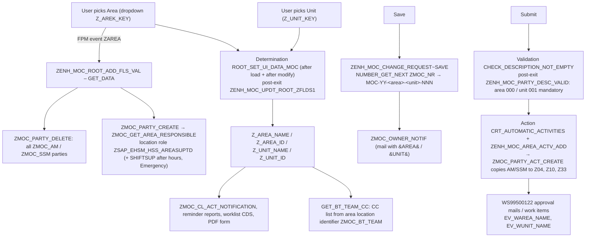
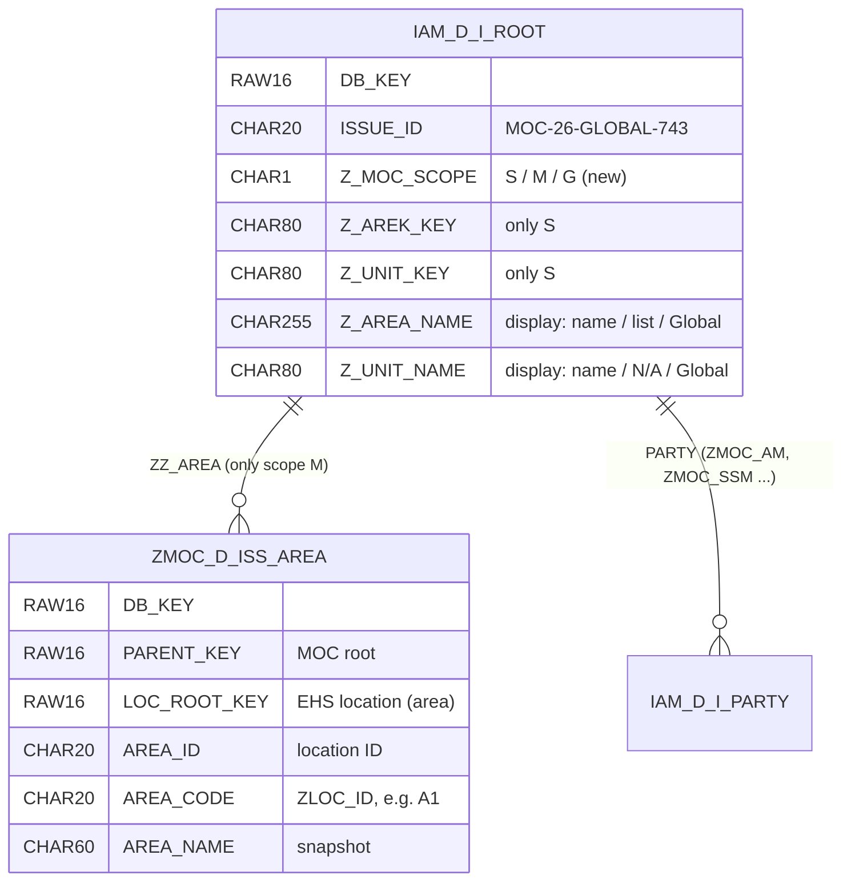
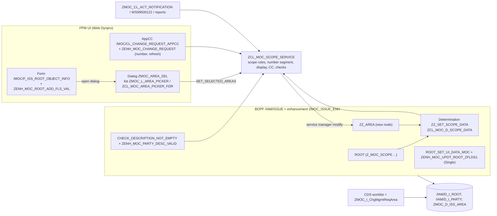

# ZMOC – Global MOC and Multiple-Area MOC
## Impact Analysis and Solution Design

| Item | Value |
| --- | --- |
| System | DVJ, client 120 (S/4HANA 2023, SAP_BASIS 758) |
| Scope | Package ZMOC on top of standard BO `/IAM/ISSUE` and the `/MOC/` FPM change-request UI |
| Source of analysis | ZMOC extract of 29.10.2026 (`sap-pkg-zmoc-index`, `-vol-01`, `-vol-02`), cross-checked against the `/IAM/` and `/MOC/` extracts of the same day |
| Companion document | `02_Technical_Build_Guide.md` (DDIC, BOPF, FPM configuration and complete ABAP) |
| Status | Draft for review – version 0.1, 29.10.2026 |

---

## 0. Executive summary

Every MOC today holds exactly **one Area and one Unit** (`Z_AREK_KEY` / `Z_UNIT_KEY` plus derived name and ID fields in append `ZMOC_ROOT_S` on `/IAM/D_I_ROOT`). That pair drives five things:

1. the MOC number `MOC-26-A1-U111-742`,
2. automatic **Area Manager** (and, for an after-hours Emergency MOC, **Site Shift Manager**) in *People Involved*,
3. the mandatory-field checks at submit,
4. the CC distribution list ("BT team") on TRC and VP approvals,
5. the Area/Unit text in every e-mail, work item, reminder, worklist column and the PDF form.

The recommended design keeps your approach (a flag on the root, a separate table for the areas, a popup) and changes four details so that it stays clean and safe:

| # | Recommendation | Why |
| --- | --- | --- |
| 1 | **One field "Area Scope" `Z_MOC_SCOPE` = Single / Multiple / Global** (radio-button group) instead of two checkboxes | Mutually exclusive by design – "only one of the three can be chosen" needs no extra check, and a fourth option later is just a new value. |
| 2 | **Store multiple areas in a BOPF enhancement node `ZZ_AREA`** under the MOC root (still your custom table, but registered in BO `/IAM/ISSUE`) | `/IAM/ISSUE` is flagged extensible (`EXTENDIBLE = X`). The areas are then saved, cancelled, locked and deleted together with the MOC, and validations/determinations can read them. A plain table written from the UI cannot guarantee that. |
| 3 | **Keep `Z_AREA_NAME` / `Z_UNIT_NAME` as the display contract** and fill them per scope: `Global`/`Global`, or `Area 1, Area 3`/`N/A` | More than 15 consumers (owner mail, activity mails, workflow work-item texts, two reminder reports, the worklist CDS, the PDF form) read only these two fields. They keep working with **no code change**. |
| 4 | **One central class `ZCL_MOC_SCOPE_SERVICE`** for number segment, display text, CC list and submit checks | Today the area logic is repeated in six places. After the change every consumer asks one class, so a future change happens once. |

Numbers keep the **single shared counter** (`ZMOC_NR`, interval 01 per year) and only the middle segment depends on the scope:

| Scope | Example |
| --- | --- |
| Single Area | `MOC-26-A1-U111-743` (or `MOC-26-A1-743` when the area has no unit) |
| Global | `MOC-26-GLOBAL-743` |
| Multiple Areas | `MOC-26-MULTIPLE-743` (token `MULTIPLE` confirmed by the client; 19 of 20 characters) |

**Area Manager and Site Shift Manager** stay automatic only for Single Area. For Global and Multiple Areas they are selected manually, and **submit is blocked until at least one Area Manager is maintained** – otherwise the Initial Review (Z04), Startup Approval (Z10) and Final Approval (Z33) activities would have no approver.

**Change footprint:** 6 existing objects change (4 enhancements, 1 class, 1 append), about 8 new objects, 3 FPM configurations; 15+ consumers stay as they are.

**Decisions needed from the client before build** (details in section 14): shared counter vs. own counters for Global/Multiple (the examples `MOC-26-GLOBAL-001` / `MOC-26-MULTIPLE-001` start at 001 – with the shared counter they continue the common sequence), whether one Area Manager approves for all areas of a multi-area MOC, and whether scope/areas may change after submission. The multi-area token `MULTIPLE` is already decided.

---

## 1. Requirement understanding

| ID | Requirement | Source |
| --- | --- | --- |
| R1 | A MOC can be **Global**: Area and Unit fields disappear, the record is marked Global. | Client |
| R2 | Global number format `MOC-26-GLOBAL-001`. | Client (mandatory) |
| R3 | Global: Area Manager **not** derived automatically – manual selection; Site Shift Manager also manual at creation. | Client |
| R4 | Global e-mails show Area = `Global` and Unit = `Global`. | Client |
| R5 | A MOC can involve **multiple areas**, chosen via button/popup; the selected areas are shown on screen and can be edited later. | Client |
| R6 | Multiple areas are stored in a separate custom table; the root carries a flag. | Team approach |
| R7 | Multiple: no Unit; no automatic Area Manager. | Client |
| R8 | Multiple e-mails show the area names; Unit shows `N/A`. | Client |
| R9 | Single / Multiple / Global are mutually exclusive. | Client |
| R10 | All existing impacts of area/unit (number, people, checks, CC, outputs, reporting, workflow) must be handled; existing single-area behaviour must not regress. | Team |

---

## 2. How Area / Unit works today (as-is)



Key facts from the code (file references are to the ZMOC extract, volume 01):

| Topic | Fact | Where |
| --- | --- | --- |
| Storage | `ZMOC_ROOT_S` (append to `/IAM/INCL_EEW_I_ROOT`): `Z_AREK_KEY` CHAR80 (location root UUID as hex), `Z_AREA_ID` CHAR20, `Z_AREA_NAME` CHAR80, same three for unit, plus `Z_MOC_CNO` "custom number assigned". | `reference/part-0045.md` (TABL ZMOC_ROOT_S) |
| Area list | MOC-relevant areas = location revisions of type `ZEHFND_LTY_AA` with identifier `ZMOC_LOC = X`, valid to 31.12.9999; units = child locations of type `ZEHFND_LTY_PL`. | `part-0025.md` lines 480–572 |
| Auto people | Only on FPM event `ZAREA` (area dropdown change): delete all `ZMOC_AM`/`ZMOC_SSM`, then create from the location's responsible persons. SSM only for Emergency MOC outside 07:00–16:00 (`SY-UZEIT`). | `part-0025.md` lines 637–719 |
| Derived names | Post-exit of determination `ROOT_SET_UI_DATA_MOC` (`/IAM/CL_I_D_ROOT_UIDATA_TR_MOC`) fills names and IDs from the keys; runs after loading (A) and after modify (F). | `part-0025.md` lines 1252–1546; `/IAM/ISSUE` DET_CONF |
| Number | Post-exit of `/MOC/CL_CHANGE_REQUEST_APPCC->IWCI_IF_FPM_TRANSACTION~SAVE`: first save draws `ZMOC_NR`/01 (1–999 per year) and writes `MOC-YY-<area ZLOC_ID>-<unit ZLOC_ID>-NNN` with a direct `UPDATE /IAM/D_I_ROOT`; edit save **splits the ID into exactly 5 parts** and rebuilds it. | `part-0021.md` lines 467–615; NROB in `part-0037.md` line 1566 |
| Submit checks | Area mandatory (`ZMOC_MSG` 000), unit mandatory if the area has units (001, via `ZCL_EHSM_UTILITY=>ZIS_UNIT_AVAILABLE`). | `part-0023.md` lines 915–995 |
| Activities | `ZMOC_PARTY_ACT_CREATE` copies the issue's `ZMOC_AM`/`ZMOC_SSM` to activities configured in `/IAM/C_ACTPTY` (Z04 AM/SSM, Z10 AM, Z33 AM). If an SSM exists, Z04 goes to the SSM only. | `part-0033.md` lines 1–446 |
| Approval | `WS99500122` has a single dialog step "MOC - Approval" (TS99500497) sent to all approvers – **the first one to decide completes it**. | `part-0038.md` (PDWS 99500122) |
| CC list | On approval of Z06 (TRC) and Z19 (VP Committee) the CC list is read from the *area* location identifier `ZMOC_BT_TEAM`. | `part-0015.md` line 709, 1373; `part-0016.md` line 350 |
| E-mails | `GET_MOC_DETAILS` reads `Z_AREA_NAME`/`Z_UNIT_NAME`; `BUILD_HTML` replaces `&AREA&`/`&UNIT&`. Workflow containers `EV_WAREA_NAME`/`EV_WUNIT_NAME` get the same values. | `part-0015.md` lines 864–912 |
| Customizing | `ZMOC_AM` is **not** mandatory in `/IAM/C_ISS_PARTY`; `ZMOC_SSM` is allowed only for issue type ZC3 (Emergency). | `part-0116.md` line 1247 |
| BO | `/IAM/ISSUE`: `EXTENDIBLE = X`, `ENQUEUE_SCOPE = 1`, buffer `/IAM/CL_BUF_DISPATCHER`. | `sap-pkg-iam-vol-01`, BOBF /IAM/ISSUE |

---

## 3. Impact analysis – complete inventory

Legend: **Change** = code/config change needed, **Auto** = works without change once the display fields are filled per scope, **None** = not affected.

| # | Object | Type | What it does with Area/Unit today | Impact for Global / Multiple | Action |
| --- | --- | --- | --- | --- | --- |
| 1 | `ZMOC_ROOT_S` | Append | Holds area/unit keys, IDs, names | Needs the scope flag; `Z_AREA_NAME` (80) too short for a list of areas | **Change**: add `Z_MOC_SCOPE`; widen `ZANAME_DE` to 255 |
| 2 | `ZENH_MOC_ADDITIONAL_FIELDS` | FPM config enh. of form `/MOC/F_ISS_ROOT_OBJECT_INFO` | Area/Unit dropdowns in group "General" | Needs scope radio group, "Affected Areas" text, "Select Areas…" button | **Change** (config) |
| 3 | `ZENH_MOC_ROOT_ADD_FLS_VAL` | Post-exits of `/MOC/CL_UIFDR_ROOT_OBJ_INF_FRM` | Builds dropdowns, sets mandatory flags, on `ZAREA` deletes/creates AM and SSM | Must hide/show fields per scope, skip AM/SSM derivation, open the popup | **Change** |
| 4 | `ZENH_MOC_UPDT_ROOT_ZFLDS1` | Post-exit of determination `ROOT_SET_UI_DATA_MOC` | Derives names/IDs from keys on every load/modify | Must not touch Global/Multiple records | **Change** (one guard) |
| 5 | `ZENH_MOC_PARTY_DESC_VALID` | Post-exit of validation `CHECK_DESCRIPTION_NOT_EMPTY` (submit) | Area 000 / Unit 001 mandatory | Wrong for Global/Multiple; new checks needed (≥ 2 areas, ≥ 1 Area Manager) | **Change** |
| 6 | `ZENH_MOC_CHANGE_REQUEST` (`SAVE`, `AFTER_PROCESS_EVENT`) | Post-exits of `/MOC/CL_CHANGE_REQUEST_APPCC` | Builds and rebuilds the MOC number; refresh after dialog | 5-part `SPLIT` breaks for `MOC-26-GLOBAL-743`; refresh needed after the area popup | **Change** |
| 7 | `ZMOC_CL_ACT_NOTIFICATION` → `GET_BT_TEAM_CC`, `SEND_NOTIFICATION`, `SEND_NOTIF_INBOX` | Class | CC list from the single area | Global has no area, Multiple has several | **Change** (call service) |
| 8 | `ZMOC_NR` | Number range object | Shared counter 1–999 per year | None with a shared counter (see Q2) | None |
| 9 | `ZMOC_PARTY_CREATE`, `ZMOC_GET_AREA_RESPONSIBLE`, `ZMOC_PARTY_DELETE` | FMs | Location role → BP parties | Simply not called for Global/Multiple | None |
| 10 | `ZENH_MOC_AREA_ACTV_ADD`, `ZMOC_PARTY_ACT_CREATE` | Enh. / FM | Copy issue AM/SSM to Z04/Z10/Z33 at activity creation | Works with manually selected parties | None (behaviour note F10) |
| 11 | `ZMOC_CL_ACT_NOTIFICATION` → `GET_MOC_DETAILS`, `BUILD_HTML` | Class | `&AREA&`, `&UNIT&` from root names | Gets `Global` / list / `N/A` | Auto |
| 12 | `ZMOC_OWNER_NOTIF` | FM | Owner mail on first save with area/unit | Gets `Global` / list / `N/A` | Auto (F7 optional fix) |
| 13 | `ZMOC_CL_ACTIVITY_WF_CONNECT` (`SEND_MAIL`), `WS99500122`, `TS99500494`, `TS99500497` | Class / workflow | Container `EV_*AREA_NAME`, `EV_*UNIT_NAME`; work-item text "Area Name: &IV_DAREA_NAME&" | Typed with `ZANAME_DE`/`ZUNAME_DE` – follow the length change | Auto (retest) |
| 14 | `ZMOC_REMINDER_NOTIFICATION`, `ZMOC_BG_EXE_REMINDER_NOTIF` | Reports | Show area/unit names in reminder mails (recipient = MOC owner) | Gets new texts | Auto |
| 15 | `ZMOC_I_CHGMGMTREQUEST`, `ZMOC_I_CHGMGMTREQWORKLIST`, `ZMOC_C_CHGMGMTREQWORKLIST`, MDE | CDS extensions | Area / Unit column and filter in the worklist | Show texts automatically; scope column/filter is missing | **Change** (recommended) |
| 16 | `ZEHS_MOC_MANCHGREQ_SRV` (MPC/DPC_EXT) | OData (SADL on CDS) | Exposes the worklist | New CDS field appears after metadata refresh | Regenerate / cache cleanup |
| 17 | `ZMOC_CHANGE_REQUEST_FORM` | Adobe form | Prints `Z_AREA_NAME`, `Z_UNIT_NAME` | List of areas needs a multi-line field | **Change** (layout) |
| 18 | `ZMOC_MSG` | Message class | 000/001 area/unit mandatory | New messages 031–036 | **Change** |
| 19 | `ZENH_MOC_OVP_OVRALL_CQ` | FPM config enh. of OVP `/MOC/OVP_CHANGE_REQUEST` | Already adds dialogs (e.g. Switch Action) | Needs the dialog "Select Affected Areas" | **Change** (config) |
| 20 | `ZENH_MOC_ISS_PARTY_PEOPLE_INVO` | FPM config enh. of `/MOC/L_ISS_PARTY_PEOPLE_INVOLVED` | People Involved list | Hint text should mention Global / Multiple | **Change** (text) |
| 21 | `ZRAS_CUSTOM_FLD_S` (package ZRISK) | Append on Risk Assessment | RA has its own `Z_AREA_ID`, `Z_AREA`, `Z_UNIT`, `Z_MOC_REF` | If the RA app defaults area from the MOC, Global/Multiple need a rule | **Verify** (outside ZMOC) |
| 22 | `ZEHS_MOC_BIDASHBOARD_SRV` | OData | Not readable in the extract | If it groups by area, use the per-area view (6.8) | **Verify** |
| 23 | `/IAM/C_ISS_PARTY`, `/IAM/C_ACTPTY` | Customizing | AM/SSM roles per issue/activity type | Unchanged; SSM stays Emergency-only (Q9) | None |
| — | `ZENH_MOC_FLDS_VISIB_VALD` | Enh. | Declares area/unit variables but never uses them | — | None |
| — | `ZMOC_PARTY_CREATION` | FM | Has `IM_AREA_KEY` but is not called | — | None |
| — | `ZCL_ZEHS_MOC_MANCHGREQ_DPC_EXT` | Class | No area logic | — | None |

Coverage check: a search over the whole ZMOC extract for location-master access (`EHFNDD_LOC*`, `CL_EHFND_LOC_HELPER`, `GET_RESPONSIBLE_PERSON`) returns only the objects in rows 3, 4, 6, 7 and 9 plus `ZCL_EHSM_UTILITY` – there is no hidden area logic elsewhere.

---

## 4. Findings in the current code that affect this change

| ID | Finding | Effect | Handled by |
| --- | --- | --- | --- |
| F1 | Edit save rebuilds the MOC number with `SPLIT … INTO prefix year area unit seq` (fixed 5 parts). | `MOC-26-GLOBAL-743` has 4 parts → the sequence would be lost. | Rebuild keeps year (2nd segment) and running number (last segment) and replaces only the middle. |
| F2 | An empty unit identifier produces a double hyphen – your screenshot `MOC-26-A1--742`. The unit *HP HDS - TR2* has no `ZLOC_ID` identifier on its current revision (or the revision is not valid to 31.12.9999). | Ugly numbers; possible master-data gap. | Builder skips empty segments; check the unit's identifiers in the location master. |
| F3 | `ISSUE_ID` is CHAR20; `CONCATENATE` truncates silently when area + unit codes are long. | Wrong, possibly duplicate-looking numbers. | Length check **before** a number is drawn (message 035). |
| F4 | Area/Unit (and thus the derived AMs) can still be changed after submission, but Z04/Z10/Z33 parties are copied only once at activity creation. | Issue and activities can disagree on who approves. | Recommend locking scope and areas after submission (Q6); admins can still change. |
| F5 | Auto-derived AM/SSM are created with origin `MN` ("Manually Entered") and `ZMOC_PARTY_DELETE` deletes every party of the role. | Auto and manual entries cannot be told apart. | Scope switch resets AM/SSM only when leaving Single Area with an area selected (same rule as today's area change). |
| F6 | After-hours check uses `SY-UZEIT` (application-server time zone); the comment says Saudi time. | Wrong SSM logic if the server is not on AST. | Same rule reused in one method (`IS_AFTER_OFFICE_HOURS`); verify server time zone. |
| F7 | `ZMOC_OWNER_NOTIF` types the unit text with `ZUNIT_DE` (CHAR60) although `Z_UNIT_NAME` is CHAR80, and calls `COMMIT WORK AND WAIT` inside the FPM save exit. | Long unit names truncated; commit inside UI save. | Not required for this change; optional clean-up. |
| F8 | The post-exit of `ROOT_SET_UI_DATA_MOC` writes persistent fields on every *after loading* call, changed or not. | MOCs may be flagged as changed on display. | New determination writes only real deltas. |
| F9 | `GET_DATA` of the root form performs BOPF modifications (party delete/create). | Works, but business rules live in the UI. | New rules live in a BOPF determination; the UI only shows/hides. |
| F10 | The approval step is one work item for all agents – first decision wins. | For Multiple Areas, one AM of any area approves for all. | Business decision Q3. |
| F11 | `ZMOC_AM` is not mandatory in customizing; nothing checks that an AM exists at submit. | A MOC of a non-operational area can be submitted with no approver today. | New check for Global/Multiple; recommend also for Single (Q7). |

---

## 5. Options considered

| Option | Pros | Cons | Verdict |
| --- | --- | --- | --- |
| Two checkboxes (Global, Multiple) | Matches the first idea | Both can be ticked → extra cross-checks; every consumer needs two IFs | Replaced by one 3-value scope field |
| Virtual "GLOBAL" location in the EHS location master | Almost no code for Global | Pollutes the location master used by Incident and Risk Assessment; number `MOC-26-GLOBAL--NNN`; no answer for Multiple | Rejected |
| Reuse standard *Related Objects* (`OBJECT_REFERENCE` node, location type) for multiple areas | Standard node, no new table | Related Objects are hidden in your UI (`ZENH_MOC_REF_RELOBJT_HIDE`); mixes "affected area" with generic references | Rejected |
| Nested change requests (one child MOC per area, action `DET_I_NESTED_MOC`) | Each area approves and executes separately | Multiplies MOC records, numbers and workflows | Only if each area must approve/execute independently (Q3) |
| Plain custom table `ZMOC_D_MOC_AREA` written from the UI / save exit | Familiar pattern | Needs own buffer, cancel and failed-save handling, deletion with the MOC, own audit trail | Fallback if BOBX is not possible (build guide §11) |
| **BOPF enhancement node `ZZ_AREA` (BOBX)** | Transactional with the MOC; locked, cancelled, deleted with it; readable in determinations/validations; SAP-supported extension of an extensible BO | One-time BOBX setup; verify in a short spike | **Recommended** |
| Only a text list in `Z_AREA_NAME` | Trivial | No keys for CC/reporting, no reliable edit | Rejected (kept as display only) |

---

## 6. Target solution

### 6.1 Data model



| Field | Single Area (S) | Multiple Areas (M) | Global (G) |
| --- | --- | --- | --- |
| `Z_MOC_SCOPE` | `S` (default; blank = S for old MOCs) | `M` | `G` |
| `Z_AREK_KEY` / `Z_UNIT_KEY` | selected area / unit | cleared | cleared |
| `ZZ_AREA` rows | none | ≥ 2 | none |
| `Z_AREA_NAME` | area name (unchanged logic) | `Area 1, Area 3, Area 5` (sorted; `(+n more)` if > 255 chars) | `Global` |
| `Z_AREA_ID` | location ID | blank | blank |
| `Z_UNIT_NAME` | unit name | `N/A` | `Global` |
| `Z_UNIT_ID` | unit ID | blank | blank |

### 6.2 Behaviour per scope

| Aspect | Single Area (today) | Multiple Areas | Global |
| --- | --- | --- | --- |
| Screen | Area + Unit dropdowns | "Affected Areas" read-only list + **Select Areas…** button (popup) | No Area/Unit fields |
| MOC number | `MOC-26-A1-U111-743` | `MOC-26-MULTIPLE-743` | `MOC-26-GLOBAL-743` |
| Area Manager | Automatic on area selection | Manual | Manual |
| Site Shift Manager | Automatic for Emergency after hours | Manual (Emergency only) | Manual (Emergency only) |
| Submit checks | Area (000), Unit if area has units (001) | ≥ 2 areas (032), ≥ 1 Area Manager (031) | ≥ 1 Area Manager (031) |
| Warning | – | Emergency after hours without SSM (033) | same |
| E-mails, work items, reminders, PDF, worklist | Area name / Unit name | Area names / `N/A` | `Global` / `Global` |
| BT-team CC (TRC, VP approval) | Area's `ZMOC_BT_TEAM` | Union of all selected areas (no duplicates) | TVARVC `ZMOC_BT_TEAM_GLOBAL` |

### 6.3 Screen design

Group **General** of the *Basic Information and Dates* section:

```
Single Area (default)
  Area Scope:      (•) Single Area   ( ) Multiple Areas   ( ) Global
  Area Name:       [ Area 1                                         v ]
  Unit Name:       [ High Pressure Hydrogensulphide (HP HDS) - TR2  v ]
  MOC Basis / Classification: ...

Multiple Areas
  Area Scope:      ( ) Single Area   (•) Multiple Areas   ( ) Global
  Affected Areas:  Area 1, Area 3, Utilities & Offsites      [ Select Areas… ]

Global
  Area Scope:      ( ) Single Area   ( ) Multiple Areas   (•) Global
  (Area and Unit fields are not shown)
```

Popup **Select Affected Areas** (FPM dialog box, list with checkbox column):

```
+-- Select Affected Areas ---------------------------------------------+
| [Select All] [Deselect All]                        Filter: [_______] |
| Sel | Area Code | Area Name                  | Location ID           |
| [x] | A1        | Area 1                     | 50000012              |
| [x] | A3        | Area 3                     | 50000014              |
| [ ] | A2        | Area 2                     | 50000013              |
|                                                     [ OK ] [Cancel]  |
+----------------------------------------------------------------------+
```

UX rules:

* Selected areas are listed first; the list is the same as the Area dropdown (`ZMOC_LOC = X`, current revision).
* **OK** with fewer than 2 areas keeps the popup open with message 032.
* In display mode (or when the scope is locked) the button reads **View Areas** and the popup shows only the selected areas, read-only.
* Switching *Single → Multiple* pre-selects the area chosen so far, so nothing is lost.
* An area that was selected but is no longer MOC-relevant in the location master stays in the list as selected (never removed silently).
* People Involved hint text: *"For Global / Multiple-Area MOCs and Non-Operational Areas, select the Area Manager manually (and the Site Shift Manager for Emergency MOCs raised after office hours)."*

### 6.4 MOC number

* Counter: unchanged – `ZMOC_NR`, range 01, per year, shared by all scopes. Uniqueness comes from the running number, so changing the middle segment can never create a duplicate.
* Middle segment from `ZCL_MOC_SCOPE_SERVICE=>GET_NUMBER_SEGMENT`:
  `S` → `<area ZLOC_ID>[-<unit ZLOC_ID>]` (empty unit skipped), `G` → `GLOBAL`, `M` → `MULTIPLE`.
* Length budget: `ISSUE_ID` is CHAR20, so the middle segment may have at most 9 characters (`MOC-26-` + segment + `-NNN`). `GLOBAL` (6) and `MULTIPLE` (8) fit; for Single Area the area and unit codes together (incl. hyphen) must stay within 9 characters.
* First save: length check first (≤ 20 characters), then draw the number, then write the ID.
* Edit save: keep year and running number of the existing ID, replace only the middle segment (`MOC-26-A1-U111-743` → `MOC-26-GLOBAL-743`).
* If the client wants Global and Multiple to restart at 001 (Q2): add intervals 02 (Global) and 03 (Multiple) to `ZMOC_NR`, draw from the interval of the scope, and freeze the scope after the first save (otherwise a scope change would need a new number). The service method `GET_NUMBER_RANGE_INTERVAL` in the build guide is the single place to switch this on.

### 6.5 Area Manager and Site Shift Manager

| Situation | Behaviour |
| --- | --- |
| Single Area, area selected/changed | Unchanged: delete all AM/SSM, derive from location roles. |
| Switch Single → Global/Multiple **with an area selected** | AM/SSM derived from that area are removed (they belong to the old area); info message 036 asks to maintain them manually. |
| Switch Global ↔ Multiple | Manually maintained people are kept. |
| Switch Global/Multiple → Single | Nothing until an area is chosen; then today's derivation replaces AM/SSM. |
| Submit, Global/Multiple | At least one `ZMOC_AM` required (031). |
| Activity creation | Unchanged: `ZMOC_PARTY_ACT_CREATE` copies the manually selected AM/SSM to Z04/Z10/Z33. If an SSM is maintained on an Emergency MOC, Z04 goes to the SSM. |

The reset logic runs in a BOPF determination (not in the UI), so it is the same for every channel and does not depend on UI state.

### 6.6 Submit validations

All scope rules sit in `ZCL_MOC_SCOPE_SERVICE=>CHECK_SUBMIT`, called from the existing post-exit `ZENH_MOC_PARTY_DESC_VALID` (so the standard "submitted for review" message still does not fire together with an error).

| Msg | Type | Text | When |
| --- | --- | --- | --- |
| 000 | E | Area name is Mandatory Field (existing) | S, no area |
| 001 | E | Unit name is Mandatory Field (existing) | S, area has units, no unit |
| 031 | E | Area Manager is mandatory for &1 MOC. Select at least one Area Manager in People Involved | G or M without `ZMOC_AM` |
| 032 | E | Select at least two areas for a Multiple Areas MOC | M with < 2 areas |
| 033 | W | Emergency MOC after office hours: consider adding the Site Shift Manager | G/M, ZC3, after hours, no SSM |
| 034 | E | Area Scope and areas can only be changed while the MOC is In Preparation | (UI lock message, optional backend check) |
| 035 | E | MOC number cannot be built: area segment &1 is too long (max. 20 characters) | Save |
| 036 | I | Area Manager / Site Shift Manager are not determined automatically for &1 MOC – maintain them in People Involved | After switching scope |

### 6.7 Notifications and workflow

* No change to SO10 texts, `ZMOC_NOTF_TBL`, `ZMOC_ACT_CUS_STA`, `WS99500122` or its tasks – they consume `Z_AREA_NAME` / `Z_UNIT_NAME`.
* `ZMOC_CL_ACT_NOTIFICATION`: the two call sites of `GET_BT_TEAM_CC` call `ZCL_MOC_SCOPE_SERVICE=>GET_BT_TEAM_CC( issue key )`, which returns the area list (S), the union over all selected areas (M) or the TVARVC list (G).
* Retest the work-item text of TS99500497 ("Area Name: …") after the length change of `ZANAME_DE`.

### 6.8 Reporting and outputs

* Worklist (`C_ChgMgmtReqWorklist` extensions + MDE): new column and filter **Area Scope**; the Area column label becomes *Area(s)*. Filtering a multi-area MOC by one area works with "contains" (`*Area 3*`).
* Optional per-area view `ZMOC_I_ChgMgmtReqArea` (one row per MOC and affected area; `GLOBAL` row for Global MOCs) for dashboards, so a multi-area MOC is counted in each of its areas.
* PDF `ZMOC_CHANGE_REQUEST_FORM`: make the Area field multi-line ("expand to fit"); optionally print the scope.
* Reminder reports: no change.

### 6.9 Lifecycle and locking (recommended, Q6)

* Scope and areas editable while the MOC is **In Preparation (01)**.
* After submission: read-only for normal users; users in the admin role (`ZMOC_CHK_ADMIN_ROLE`, TVARVC `ZEHS_MOC_ADMIN_ROLE`) may still change them – they must then also adjust the approvers of open activities.
* Area/Unit dropdowns of Single Area follow the same rule (closes finding F4).

### 6.10 Authorization, audit trail, logging

* No new authorization object; MOC change authorization (`/IAM/` issue authority) applies unchanged. The scope lock is enforced in the UI and in the backend by validation `ZZ_CHECK_SCOPE_LOCK` (build guide §4.2), so it also holds for non-UI channels.
* `/IAM/ISSUE` is shared by all IAM applications; the new determination and validation act only on records with `APPLICATION = 'MOC'`.
* Audit trail: set the *Change document* flag on `ZMOC_SCOPE_DE` and `ZANAME_DE`. If `/IAM/D_I_ROOT` belongs to change-document object `/IAM/ISSUE` (verify in SCDO), scope and area-list changes appear in the MOC change history; the area list is reflected through `Z_AREA_NAME`.
* Errors are reported as BOPF/FPM messages (`ZMOC_MSG`); number-range errors keep today's handling.

---

## 7. Technical architecture



Design principles:

* Business rules (defaults, clean-up on scope switch, display texts) live in **BOPF** (determination) and **one service class**; UI exits only show/hide fields and open the popup.
* Enhancements of standard classes stay thin and delegate to Z classes (upgrade safety).
* Determinations are **idempotent**: they write only fields whose value really changes.

---

## 8. Development object inventory

| Object | Type | New / Changed | Purpose | Depends on | Size |
| --- | --- | --- | --- | --- | --- |
| `ZMOC_SCOPE_DO` / `ZMOC_SCOPE_DE` | Domain / Data element | New | Area Scope S/M/G (change document flag on) | – | S |
| `ZMOC_AREA_TXT_DO` | Domain | New | CHAR255 lower case, assigned to `ZANAME_DE` | – | S |
| `ZMOC_AREA_CODE_DE` | Data element | New | Area code (`ZLOC_ID`) CHAR20 | – | S |
| `ZMOC_ROOT_S` | Append | Changed | + `Z_MOC_SCOPE` | `ZMOC_SCOPE_DE` | S |
| `ZANAME_DE` | Data element | Changed | Domain → `ZMOC_AREA_TXT_DO` (80 → 255) | `ZMOC_AREA_TXT_DO` | S |
| `ZMOC_S_ISS_AREA_D`, `ZMOC_S_ISS_AREA`, `ZMOC_T_ISS_AREA`, `ZMOC_D_ISS_AREA` | Structures / table type / table | New | Node `ZZ_AREA` | BOBX | S |
| `ZMOC_ISSUE_ENH` (+ `ZIF_MOC_ISSUE_X_C`) | BOPF enhancement object | New | Node `ZZ_AREA`, determination `ZZ_SET_SCOPE_DATA` | `/IAM/ISSUE` | M |
| `ZCL_MOC_D_SCOPE_DATA` | Class (determination) | New | Default scope, clean-up on switch, display texts | service class | M |
| `ZCL_MOC_V_SCOPE_LOCK` | Class (validation) | New (if Q6 = lock) | Backend lock of scope/areas after submission | service class | S |
| `ZCL_MOC_SCOPE_SERVICE` | Class | New | Central scope logic | node, DDIC | M |
| `ZCL_MOC_AREA_PICKER_FDR` | Class (FPM list feeder) | New | Area popup | service class | M |
| `ZMOC_L_AREA_PICKER` | WD component configuration (FPM_LIST_UIBB_ATS) | New | Popup list layout | feeder | S |
| `ZENH_MOC_ROOT_ADD_FLS_VAL` | Enhancement | Changed | Scope field control, popup, AM/SSM only for Single | service, feeder | M |
| `ZENH_MOC_UPDT_ROOT_ZFLDS1` | Enhancement | Changed | Skip non-Single | service | S |
| `ZENH_MOC_PARTY_DESC_VALID` | Enhancement | Changed | Scope-aware submit checks | service, node | S |
| `ZENH_MOC_CHANGE_REQUEST` | Enhancement | Changed | Number via service, refresh after popup | service | S |
| `ZMOC_CL_ACT_NOTIFICATION` | Class | Changed | CC via service | service | S |
| `ZENH_MOC_ADDITIONAL_FIELDS` | FPM config enhancement | Changed | Scope radio group, Affected Areas, button | DDIC | S |
| `ZENH_MOC_OVP_OVRALL_CQ` | FPM config enhancement | Changed | Dialog box `ZMOC_AREA_SEL` | `ZMOC_L_AREA_PICKER` | S |
| `ZENH_MOC_ISS_PARTY_PEOPLE_INVO` | FPM config enhancement | Changed | Hint text | – | S |
| `ZMOC_MSG` 031–036 | Messages | New | Texts | – | S |
| CDS `ZMOC_I_CHGMGMTREQUEST`, `ZMOC_I_CHGMGMTREQWORKLIST`, `ZMOC_C_CHGMGMTREQWORKLIST`, MDE | CDS | Changed | Scope column/filter | DDIC | S |
| `ZMOC_I_ChgMgmtReqArea` | CDS view entity | New (optional) | Per-area reporting | node table | S |
| `ZMOC_CHANGE_REQUEST_FORM` | Adobe form | Changed | Multi-line area field | – | S |
| `ZMOC_SCOPE_MIGRATE` | Report | New | One-time scope = S for existing MOCs | DDIC | S |
| TVARVC `ZMOC_BT_TEAM_GLOBAL` | Variable | New | CC list for Global MOCs | – | S |

Unchanged on purpose: SO10 texts, `ZMOC_NOTF_TBL`, `ZMOC_ACT_CUS_STA`, `WS99500122` and tasks, reminder reports, `ZMOC_PARTY_ACT_CREATE`, `ZENH_MOC_AREA_ACTV_ADD`, `ZMOC_GET_AREA_RESPONSIBLE`, `ZMOC_PARTY_CREATE`, `ZMOC_NR`, OData DPC_EXT.

---

## 9. Step-by-step implementation plan

Each step references the build guide section that contains the exact definition or code.

**Phase 0 – Decisions and spike**
1. Confirm decisions Q1–Q9 (section 14) with the client.
2. BOBX spike in DVJ: create a throw-away enhancement object for `/IAM/ISSUE` with one subnode; in BOBT create a MOC root + subnode, save, reload; open the MOC UI; repeat with a non-admin MOC user. Go → BOBX design. No-go → fallback (build guide §11).

**Phase 1 – Dictionary** (build guide §1)

3. Create domain `ZMOC_SCOPE_DO` (S/M/G) and data element `ZMOC_SCOPE_DE` (change document on).
4. Add `Z_MOC_SCOPE` to append `ZMOC_ROOT_S`; activate (adjusts `/IAM/D_I_ROOT`).
5. Create domain `ZMOC_AREA_TXT_DO` (CHAR255, lower case) and assign it to `ZANAME_DE`; activate; check SE14 for `/IAM/D_I_ROOT`.
6. Create data element `ZMOC_AREA_CODE_DE`.
7. Add messages 031–036 to `ZMOC_MSG`.
8. Create TVARVC variable `ZMOC_BT_TEAM_GLOBAL` (select option, one e-mail per line).

**Phase 2 – BOPF enhancement** (build guide §2)

9. BOBX: enhancement object `ZMOC_ISSUE_ENH` for `/IAM/ISSUE`, constants interface `ZIF_MOC_ISSUE_X_C`.
10. Subnode `ZZ_AREA` under ROOT with structures/table from step 1 (`ZMOC_D_ISS_AREA`); index on `PARENT_KEY`.
11. Determination `ZZ_SET_SCOPE_DATA` on ROOT, class `ZCL_MOC_D_SCOPE_DATA`, after modify; triggers ROOT create/update and ZZ_AREA create/update/delete.
12. If Q6 = lock: validation `ZZ_CHECK_SCOPE_LOCK` on ROOT, class `ZCL_MOC_V_SCOPE_LOCK` (build guide §4.2).
13. Activate, regenerate constants, test in BOBT.

**Phase 3 – Service class** (build guide §3)

14. Create `ZCL_MOC_SCOPE_SERVICE`; add ABAP Unit tests for `BUILD_MOC_ID`, `REBUILD_MOC_ID`, `BUILD_DISPLAY`.
15. Create `ZCL_MOC_D_SCOPE_DATA` (build guide §4).

**Phase 4 – Adapt existing enhancements** (build guide §5)

16. `ZENH_MOC_UPDT_ROOT_ZFLDS1`: skip records whose scope is not Single.
17. `ZENH_MOC_ROOT_ADD_FLS_VAL`: new actions `ZSCOPE` / `ZAREA_SEL`; derive AM/SSM only for Single; field and button control per scope; open the dialog.
18. `ZENH_MOC_PARTY_DESC_VALID`: replace the area/unit block by `CHECK_SUBMIT`.
19. `ZENH_MOC_CHANGE_REQUEST~SAVE`: number via service; `~AFTER_PROCESS_EVENT`: refresh flag of the popup.
20. `ZMOC_CL_ACT_NOTIFICATION`: two call sites use `ZCL_MOC_SCOPE_SERVICE=>GET_BT_TEAM_CC`.

**Phase 5 – User interface** (build guide §5.2, §7)

21. Create feeder `ZCL_MOC_AREA_PICKER_FDR` and list configuration `ZMOC_L_AREA_PICKER`.
22. In OVP `/MOC/OVP_CHANGE_REQUEST` (enhancement `ZENH_MOC_OVP_OVRALL_CQ`) add dialog box `ZMOC_AREA_SEL` (OK/Cancel) with the list UIBB.
23. In form `/MOC/F_ISS_ROOT_OBJECT_INFO` (enhancement `ZENH_MOC_ADDITIONAL_FIELDS`) add `Z_MOC_SCOPE` (radio-button group, event `ZSCOPE`), `Z_AREA_NAME` (text view "Affected Areas") and button `ZAREA_SEL`.
24. Update the People Involved hint text.

**Phase 6 – Reporting and output** (build guide §8)

25. Extend the three CDS extensions with `z_moc_scope` and the MDE with column/filter; clean OData caches.
26. Optional: `ZMOC_I_ChgMgmtReqArea` for dashboards.
27. PDF form: multi-line Area field.
28. Check ZRISK (Risk Assessment app) and the BI dashboard for area defaulting/grouping.

**Phase 7 – Data** (build guide §9)

29. Run `ZMOC_SCOPE_MIGRATE` in test mode, then update mode, in every system after import.

**Phase 8 – Test** (section 11)

30. Unit tests, integration test incl. workflow and e-mails, regression of Single Area, UAT with Process Safety.

**Phase 9 – Transport and go-live** (section 12)

31. Import in the sequence of section 12, run migration and cache clean-up, smoke test.

---

## 10. Traceability

| Req. | Solution | Objects | Test |
| --- | --- | --- | --- |
| R1 | Scope `G`; fields hidden; keys cleared by determination | `Z_MOC_SCOPE`, `ZENH_MOC_ROOT_ADD_FLS_VAL`, `ZCL_MOC_D_SCOPE_DATA` | T04 |
| R2 | Segment `GLOBAL`, shared counter | `ZCL_MOC_SCOPE_SERVICE`, `ZENH_MOC_CHANGE_REQUEST` | T04, T17 |
| R3 | No derivation for G; reset on switch; AM mandatory at submit | `ZENH_MOC_ROOT_ADD_FLS_VAL`, `ZCL_MOC_D_SCOPE_DATA`, `ZENH_MOC_PARTY_DESC_VALID` | T05, T08, T17 |
| R4 | `Z_AREA_NAME` = `Z_UNIT_NAME` = `Global` | `ZCL_MOC_D_SCOPE_DATA` → all mail programs | T06, T26 |
| R5 | Popup with checkbox list; read-only list on screen; editable | `ZCL_MOC_AREA_PICKER_FDR`, `ZMOC_L_AREA_PICKER`, dialog `ZMOC_AREA_SEL` | T09, T10, T14 |
| R6 | Node `ZZ_AREA` (table `ZMOC_D_ISS_AREA`) + scope flag | BOBX `ZMOC_ISSUE_ENH` | T14, T15, T27 |
| R7 | Unit hidden; no AM derivation | `ZENH_MOC_ROOT_ADD_FLS_VAL`, determination | T09, T11 |
| R8 | `Z_AREA_NAME` = list, `Z_UNIT_NAME` = `N/A` | `ZCL_MOC_SCOPE_SERVICE=>BUILD_DISPLAY` | T12 |
| R9 | One field with three fixed values | `ZMOC_SCOPE_DO` | T16–T19 |
| R10 | Impact inventory (section 3), CC, CDS, PDF, workflow | see section 8 | T01–T03, T07, T13, T20–T33 |

---

## 11. Test cases

| ID | Scenario | Preconditions | Input | Expected result |
| --- | --- | --- | --- | --- |
| T01 | Single Area regression | Area A1 with unit U111 and responsibles | Create MOC, choose A1/U111, save | AMs derived; `MOC-26-A1-U111-NNN`; mail shows names |
| T02 | Single Area without units | Area without units | Choose area, save | Unit not mandatory; `MOC-26-A1-NNN` (no `--`) |
| T03 | Single Area change in draft | T01 draft | Change area to A3, save | AMs replaced; ID `MOC-26-A3-…-NNN`, same NNN |
| T04 | Global create | – | Scope Global, save as draft | Area/Unit hidden; `MOC-26-GLOBAL-NNN`; root texts Global/Global |
| T05 | Global submit without AM | T04 | Submit | Error 031, not submitted; add AM manually → submit OK; Z04 assigned to that AM |
| T06 | Global e-mails | T05 submitted | Owner + approval mails | Area: Global, Unit: Global |
| T07 | Global CC | TVARVC filled | TRC (Z06) approval | CC = TVARVC addresses |
| T08 | Global Emergency after hours | ZC3, after 16:00 | Submit without SSM / with SSM | Warning 033 / Z04 routed to SSM |
| T09 | Multiple – select | – | Scope Multiple, Select Areas, tick A1, A2, A3, OK | Affected Areas "Area 1, Area 2, Area 3"; unit hidden |
| T10 | Multiple – only one area | T09 | Tick only A1, OK | Message 032, popup stays open |
| T11 | Multiple submit without AM | T09 | Submit | Error 031 |
| T12 | Multiple number and mails | T09 + AM | Save, submit | `MOC-26-MULTIPLE-NNN`; mails list areas, Unit N/A |
| T13 | Multiple CC | Areas with `ZMOC_BT_TEAM` | VP (Z19) approval | CC = union of the three areas, no duplicates |
| T14 | Edit areas | T12 in draft | Remove A2, add A4, save | Node rows updated; text updated; change history entry (if enabled) |
| T15 | Cancel edit | T12 in draft | Change areas, cancel, reopen | Original areas |
| T16 | Single → Multiple | A1 selected, AMs derived | Switch to Multiple | A1 pre-selected; AM/SSM removed; info 036 |
| T17 | Single → Global after save | Draft `MOC-26-A1-U111-NNN` | Switch to Global, save | AM/SSM removed; ID `MOC-26-GLOBAL-NNN` (same NNN) |
| T18 | Multiple → Single | T12 draft | Switch to Single, choose area | Area rows deleted; AMs derived |
| T19 | Global ↔ Multiple | Global with manual AM | Switch to Multiple and back | Manual AM kept |
| T20 | Lock after submit | Submitted MOC, owner | Edit | Scope read-only; button "View Areas"; popup read-only |
| T21 | Admin override | User in `ZEHS_MOC_ADMIN_ROLE` | Change scope after submit | Allowed; ID rebuilt |
| T22 | Unauthorized user | No MOC change authorization | Open MOC | Standard: no edit possible |
| T23 | Worklist | Mixed MOCs | Filter Area Scope = Global | Only Global MOCs; Area(s) column shows lists |
| T24 | PDF | Multi-area MOC with 6 areas | Print change request | Full area list, no truncation |
| T25 | Reminder reports | Overdue MOCs of all scopes | Run both reports | Correct Area/Unit text in mails |
| T26 | Work-item text | Global MOC at approval | Open work item | "Area Name: Global" |
| T27 | Delete draft | Multi-area draft | Delete MOC | `ZMOC_D_ISS_AREA` rows gone |
| T28 | Legacy MOC | MOC created before go-live | Open, run migration | Treated as Single; scope = S after migration |
| T29 | Area deactivated | Area loses `ZMOC_LOC` | Open popup on old MOC | Area still shown as selected |
| T30 | Many areas | 12 areas with long names | Select all, OK | Text ends with "(+n more)"; no dump |
| T31 | Performance | Full area master | Open popup, SQL trace | < 1 s; no SELECT in loop |
| T32 | No false "changed" flag | Any MOC | Display, leave | No data-loss popup |
| T33 | Long codes | Area + unit codes > 9 characters | First save | Error 035 before a number is drawn |

---

## 12. Transport sequence and deployment checklist

| Order | Transport content |
| --- | --- |
| 1 | DDIC: domains, data elements, `ZMOC_ROOT_S`, `ZANAME_DE` change, node structures/table type/table, `ZMOC_MSG` 031–036 |
| 2 | BOPF: enhancement object `ZMOC_ISSUE_ENH`, `ZIF_MOC_ISSUE_X_C`, `ZCL_MOC_D_SCOPE_DATA`, `ZCL_MOC_V_SCOPE_LOCK` |
| 3 | Code: `ZCL_MOC_SCOPE_SERVICE`, `ZCL_MOC_AREA_PICKER_FDR`, the four enhancements, `ZMOC_CL_ACT_NOTIFICATION`, `ZMOC_SCOPE_MIGRATE` |
| 4 | UI configuration: `ZMOC_L_AREA_PICKER`, `ZENH_MOC_ADDITIONAL_FIELDS`, `ZENH_MOC_OVP_OVRALL_CQ`, `ZENH_MOC_ISS_PARTY_PEOPLE_INVO` |
| 5 | Reporting/output: CDS extensions + MDE, `ZMOC_I_ChgMgmtReqArea`, `ZMOC_CHANGE_REQUEST_FORM` |
| 6 | Variables: TVARVC `ZMOC_BT_TEAM_GLOBAL` (or maintain per system) |

Deployment checklist:

- [ ] Decisions Q1–Q9 signed off
- [ ] BOBX spike passed (or fallback chosen)
- [ ] ATC clean (no SELECT *, no SELECT in loop, no unhandled exceptions) for all new/changed objects
- [ ] `/IAM/D_I_ROOT` adjusted after `ZANAME_DE` change (SE14 log checked)
- [ ] `ZMOC_SCOPE_MIGRATE` run (test, then update) – count matches
- [ ] `/IWFND/CACHE_CLEANUP` and `/IWBEP/CACHE_CLEANUP` after CDS changes
- [ ] TVARVC `ZMOC_BT_TEAM_GLOBAL` maintained in the target system
- [ ] Location master: every MOC-relevant area and unit has a `ZLOC_ID` identifier (finding F2)
- [ ] Workflow WS99500122 smoke test (approve / reject) for Single, Multiple, Global
- [ ] Key-user training: Area Scope, popup, manual Area Manager

---

## 13. Risks and mitigations

| Risk | Likelihood | Impact | Mitigation |
| --- | --- | --- | --- |
| BOBX enhancement of `/IAM/ISSUE` not usable (authorization or buffer side effects) | Low | Medium | Phase-0 spike; fallback custom table (build guide §11) |
| Wrong approver on multi-area MOCs (any one AM approves) | Medium | High | Decision Q3; Phase 2 option: one Z04 per area |
| Users switch scope after picking people and lose AM/SSM | Medium | Low | Reset only when leaving Single with an area; info message 036 |
| `ZANAME_DE` widening touches workflow containers, CDS, PDF | Low | Low | Typed by reference; included in tests T24–T26 |
| Implicit enhancements of SAP classes on upgrade | Low | Medium | Exits delegate to Z classes; regression test after each SP |
| Number gaps if save fails after the number is drawn (exists today) | Low | Low | Length check before drawing; gaps are acceptable for MOC numbers |
| Risk Assessment / BI dashboard logic outside ZMOC | Medium | Medium | Step 27 verification |

---

## 14. Decisions to confirm with the client

| ID | Question | Recommendation |
| --- | --- | --- |
| Q1 | Number segment for Multiple Areas? | **Decided:** `MULTIPLE` → `MOC-26-MULTIPLE-001` format (19 characters; area codes cannot be listed because the ID is limited to 20 characters) |
| Q2 | Shared counter, or do Global and Multiple each restart at 001? | Shared counter (e.g. `MOC-26-GLOBAL-743`, `MOC-26-MULTIPLE-744`) – same as areas today, and a scope change can never produce a duplicate. Own counters = intervals 02 (Global) and 03 (Multiple) in `ZMOC_NR`, and the scope must then be frozen after the first save |
| Q3 | Multiple Areas: is approval by **one** selected Area Manager enough, or must every area approve? | Phase 1: one approval (today's behaviour). Phase 2 if needed: one Z04 per area |
| Q4 | Minimum number of areas for Multiple? | 2 |
| Q5 | Who is on the Global CC list (TRC / VP approval)? | Maintain in TVARVC `ZMOC_BT_TEAM_GLOBAL` |
| Q6 | May scope/areas change after submission? | No (admins only) |
| Q7 | Should "Area Manager mandatory" also apply to Single Area MOCs? | Yes – closes finding F11 (one-line change in `CHECK_SUBMIT`) |
| Q8 | How should Risk Assessments (ZRISK) and the BI dashboard treat Global/Multiple MOCs? | RA: owner picks the relevant area; dashboard: use per-area view |
| Q9 | Should the Site Shift Manager be selectable for non-emergency Global MOCs? | No – SSM only matters for Emergency Initial Review (customizing stays) |

**Phase 2 candidates:** "Add Area Managers of selected areas" button in the popup (explicit user action, not automatic), per-area approval, number drawing inside BOPF (determination at *Before Save – Draw Numbers*) to remove the direct `UPDATE`, time-zone-safe office-hours check.
